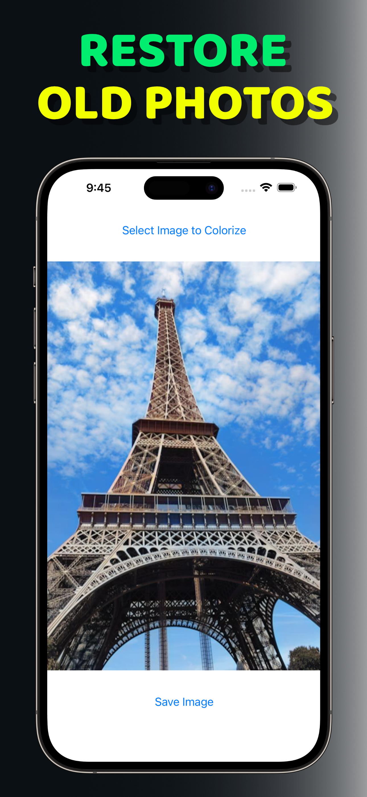

# Colorizer — AI Photo Colorization

Bring black-and-white memories to life with AI.

[Official website](https://elibooklover.github.io/Colorizer/) · [App Store](https://apps.apple.com/us/app/colorizer-colorize-photos/id6590601683) · [Google Play](https://play.google.com/store/apps/details?id=com.hoyeolkim.colorizer)

 

## Features

- AI-powered photo colorization
- Save and share colorized photos
- Flexible access options on supported platforms

[Privacy Policy](https://elibooklover.github.io/Colorizer/privacy.html) · [Terms & Conditions](https://elibooklover.github.io/Colorizer/terms.html) · [Support](mailto:appdeveloperkim@gmail.com)
