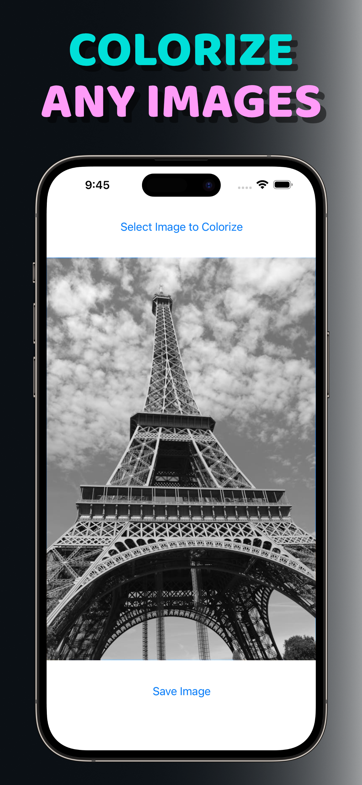

  <section class="hero">
    
Colorizer · AI Photo Colorization

    <h1>Old memories. Beautiful new colors.</h1>
    
Bring your black-and-white photos to life with AI. Rediscover the moments that matter in just a few taps.

    

      
      
    

  </section>
  <section class="section">
    <h2>See the transformation</h2>
    
From monochrome memories to vibrant color.

    
  </section>
  <section class="section">
    <h2>Made for your memories</h2>
    

      
✦<h3>AI-powered colorization</h3>
Add natural-looking colors to old black-and-white photographs.

      
◷<h3>Simple and fast</h3>
Choose a photo and let AI do the colorization for you.

      
♡<h3>Save and share</h3>
Keep your colorized memories and share them with family and friends.

    

  </section>
  <section class="section">
    <h2>Explore Colorizer</h2>
    
A simple experience, from your first photo to the final result.

    

  </section>
  <section class="pro">
    
Flexible access

    <h2>More memories with Colorizer Pro</h2>
    
Start with rewarded ads or choose a paid option that works for you.

    

      
<h3>Monthly</h3>
Monthly Pro subscription

      
<h3>Annual</h3>
Yearly Pro subscription

      
<h3>Credit Pack</h3>
One-time credit purchase

    

    
Current prices and benefits are displayed in the app.

  </section>
  <section class="section">
    <h2>Rediscover your memories in color.</h2>
    

      
      
    

  </section>
  <footer class="footer">
    
<a href="privacy.html">Privacy Policy</a> · <a href="terms.html">Terms &amp; Conditions</a> · <a href="mailto:appdeveloperkim@gmail.com">Support</a>

    
© 2026 Colorizer

  </footer>

